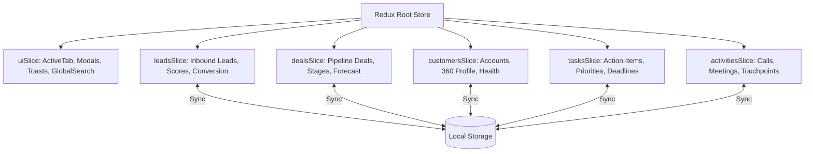

# Vanguard — Enterprise CRM Platform (User Panel)


[](https://react.dev/)
[](https://www.typescriptlang.org/)
[](https://redux-toolkit.js.org/)
[](https://tailwindcss.com/)
[](https://recharts.org/)
[](https://vite.dev/)
[](LICENSE)

**Vanguard CRM Platform** is an enterprise sales intelligence platform and high-performance User Panel designed for employees, sales representatives, and sales managers. Delivering unified lead tracking, visual Kanban deal progression, 360-degree customer accounts, prioritized task lists, touchpoint activity feeds, a dedicated Notification Center, and deep executive analytics.

Configured with authentic Indian enterprise data (`₹` INR in Lakhs and Crores) and an 8-palette theme engine styled identically to the reference benchmark (`https://enterprise-crm-platform-user-side.vercel.app/`).

---

## 📑 Table of Contents

- [Key User Panel Modules](#-key-user-panel-modules)
  - [1. Authentication Suite (5 Flows)](#1-authentication-suite-5-flows)
  - [2. Dual-Scope Cockpit (Personal vs Team)](#2-dual-scope-cockpit-personal-vs-team)
  - [3. Lead Management & Follow-up Scheduler](#3-lead-management--follow-up-scheduler)
  - [4. Sales Pipeline (Visual Kanban)](#4-sales-pipeline-visual-kanban)
  - [5. Customer Profiles & 360° Account View](#5-customer-profiles--360-account-view)
  - [6. Task Management & Deadlines](#6-task-management--deadlines)
  - [7. Activity Tracking & Touchpoint Audit Trail](#7-activity-tracking--touchpoint-audit-trail)
  - [8. Executive Reports & Analytics](#8-executive-reports--analytics)
  - [9. Real-Time Notification Center](#9-real-time-notification-center)
  - [10. User Profile, Quota & 8-Theme Visual Palette](#10-user-profile-quota--8-theme-visual-palette)
- [Technical Architecture](#-technical-architecture)
- [Prerequisites](#-prerequisites)
- [Command Line Reference (CMD)](#-command-line-reference-cmd)
  - [Interactive Windows CLI Launcher (`readme.cmd`)](#interactive-windows-cli-launcher-readmecmd)
  - [Installation & Setup](#installation--setup)
  - [Development Server](#development-server)
  - [Production Build & Verification](#production-build--verification)
  - [Production Preview](#production-preview)
- [Responsive Viewport Specifications](#-responsive-viewport-specifications)
- [Project Directory Structure](#-project-directory-structure)
- [Indian Enterprise Ecosystem & Currency Engine](#-indian-enterprise-ecosystem--currency-engine)
- [License](#-license)

---

## 🚀 Key User Panel Modules

### 1. Authentication Suite (5 Flows)
- **Sign In (Login)**: Work email and password authentication, remember-me toggle, and password reveal eye switch.
- **⚡ 1-Click Instant Demo Access**: Pre-configured login credentials as **Vikram Malhotra** (Senior Enterprise Account Executive, Bengaluru) for immediate zero-friction testing.
- **Sign Up**: Account creation with `+91` Indian mobile number validation, full name, work email, and company details.
- **Forgot Password**: Interactive recovery flow simulating secure OTP generation.
- **6-Digit OTP Verification**: Clean numeric input fields pre-filled with demo OTP `842190`.
- **Reset Password**: Password reset confirmation with immediate redirect back to login.

### 2. Dual-Scope Cockpit (Personal vs Team)
- **My Cockpit (Personal AE Scope)**: Displays personal metrics for Vikram Malhotra:
  - Personal Quota Pacing: `₹6.20 Cr / ₹7.50 Cr (83% of target)`
  - Assigned active leads and personal pipeline deals
  - High-priority assigned tasks and personal follow-ups
- **Executive Dashboard (Team Scope)**: Consolidated enterprise view across all sales representatives in Bengaluru, Mumbai, Chennai, and Gurugram.
- **One-Click Workspace Toggle**: Switch seamlessly between Personal Cockpit and Team Dashboard directly from the Header and Dashboard banner.

### 3. Lead Management & Follow-up Scheduler
- **Multi-View Catalog**: High-density **Table View** and visual **Cards Grid View**.
- **Real-Time Stage Qualification**: Inline stage dropdowns (`New`, `Contacted`, `Qualified`, `Proposal`, `Negotiation`, `Converted`, `Lost`).
- **Dynamic Lead Scoring**: 0–100 score indicator badges with color coding.
- **Follow-up Scheduler Modal**: Schedule future calls, meetings, emails, or demos with date/time pickers, agenda notes, and automatic linking to the Task list.
- **1-Click Conversion**: Converts qualified leads directly into active Customers and opens corresponding pipeline Deals.
- **Search, Filter & CSV Export**: Real-time filtering by status and 1-click export of leads to `.csv`.

### 4. Sales Pipeline (Visual Kanban)
- **Kanban Pipeline Board**: Visual stage columns:
  1. `Discovery`
  2. `Qualification`
  3. `Proposal`
  4. `Negotiation`
  5. `Closed Won`
  6. `Closed Lost`
- **Dynamic Stage Aggregation**: Real-time deal counts and Indian Rupee value sums per stage.
- **Weighted Forecasting**: Total pipeline volume alongside probability-weighted forecast (`Deal Value × Probability %`).
- **Directional Navigation**: Move deals with 1-click forward/backward buttons or edit via Deal Modal.

### 5. Customer Profiles & 360° Account View
- **Enterprise Customer Directory**: Manage accounts classified by Tier (`Enterprise`, `Mid-Market`, `Startup`, `SMB`) and Status (`Active`, `Onboarding`, `At Risk`, `Churned`).
- **Slide-Over 360° Profile Drawer**:
  - Financial KPIs: Lifetime Value (LTV), Monthly Recurring Revenue (MRR), and Contract Values in INR.
  - Key Contacts: Phone, email, HQ location, and employee headcount.
  - Linked Deals: All associated pipeline opportunities.
  - Interaction Timeline: Calls, meetings, emails, and audit logs.
  - Custom Account Tags: `SOC-2 Certified`, `RBI Compliant`, `Annual Prepay`.

### 6. Task Management & Deadlines
- **Action Item Prioritization**: Priority tags (`Urgent`, `High`, `Medium`, `Low`).
- **Category Filtering**: `Call`, `Meeting`, `Email`, `Follow-up`, `Review`, `Contract`.
- **Entity Linking**: Cross-linked to specific Leads, Deals, or Customer Accounts with jump links.
- **Fast Status Toggling**: 1-click checkbox completion (`To Do` ➔ `In Progress` ➔ `Completed`).

### 7. Activity Tracking & Touchpoint Audit Trail
- **Interaction Logging**: Log calls, meetings, emails, and notes.
- **Outcome & Duration Tracking**: Record call outcomes (`Connected`, `Voicemail`, `Completed`, `Contract Sent`, `Rescheduled`) with duration.
- **Chronological Feed**: Time-ago indicators (`15m ago`, `2h ago`) with rep avatar badges.

### 8. Executive Reports & Analytics
- **KPI Summary Strip**: Total Pipeline, Closed Revenue, Quota Attainment, Lead Conversion Rate, and Task Velocity.
- **Interactive Recharts Visualizations**:
  - **Revenue Performance vs. Target**: Area chart comparing monthly revenue to quota with **Last 6 Months** and **Full Year** toggle.
  - **Pipeline Value by Stage**: Bar chart visualizing deal distribution across stages.
  - **Lead Acquisition Channels**: Donut chart across Website, Referral, LinkedIn, Outbound, and Summits.
  - **AE Leaderboard**: Attainment progress bars per Account Executive.

### 9. Real-Time Notification Center
- **Dedicated View (`/notifications`) & Quick Popover**: Unread badge counter in Header and Sidebar.
- **Category Filters**: `All`, `Lead Assignments`, `Task Reminders`, `Meeting Alerts`, `Deal Updates`, `System`.
- **Interactive Action Links**: 1-click jump links to view the corresponding lead, deal, or task.
- **Read State Controls**: Mark individual notifications as read or `Mark All as Read`.

### 10. User Profile, Quota & 8-Theme Visual Palette
- **Profile Modal**: Edit name, title, department, work phone, and email.
- **Q4 Quota Attainment Tracker**: Visual progress bar indicating progress towards annual quota.
- **8-Theme Visual Palette Engine**:
  1. `Sunset Copper` (`#ca5e3a` dark espresso luxury - default benchmark theme)
  2. `Sapphire Blue` (enterprise deep blue)
  3. `Emerald Green` (high growth velocity green)
  4. `Royal Violet` (luxury purple)
  5. `Crimson Rose` (dynamic performance red)
  6. `Warm Amber` (gold energy)
  7. `Electric Cyan` (vibrant modern cyan)
  8. `Classic Indigo` (executive indigo)
- **High-Contrast Dark Mode & Light Mode**: Global toggle accessible in Header, Sidebar, and Profile.

---

## 🛠 Technical Architecture

```
Front-End Core:     React 19.3 (Functional Components + Modern Hooks)
Language:           TypeScript 5.x (Strict Typing)
State Engine:       Redux Toolkit (7 Slices + LocalStorage Persistence)
Styling:            Tailwind CSS v4 (Multi-Theme Data Attribute Engine)
Visualizations:     Recharts 2.x (Responsive SVG Area, Bar, and Donut Charts)
Iconography:        Lucide React
Build & Dev Tool:   Vite 8.x
```

---

## 📋 Prerequisites

- **Node.js**: `v18.0.0` or higher (Tested on `v20.x` and `v24.x`)
- **npm**: `v9.0.0` or higher (or `pnpm` / `yarn`)

---

## 💻 Command Line Reference (CMD)

All commands should be executed from the project root directory: `d:\Enterprise CRM Platform`.

### Interactive Windows CLI Launcher (`readme.cmd`)

Run the bundled interactive Command Prompt launcher:

```cmd
readme.cmd
```

Interactive Menu:
```
===============================================================================
               VEDAFLOW - SALES INTELLIGENCE PLATFORM (USER PANEL)
===============================================================================
  Modern, Responsive Enterprise CRM Dashboard with Indian Rupee (INR) Data
  Stack: React 19 + TypeScript + Redux Toolkit + Tailwind CSS + Recharts
===============================================================================

  [1] Start Vite Development Server       (npm run dev)
  [2] Build for Production               (npm run build)
  [3] Preview Production Build           (npm run preview)
  [4] Install / Update Dependencies      (npm install)
  [5] View Feature Guide and README      (Open README.md)
  [6] System & Environment Health Check  (Node, NPM, Port 5173)
  [7] Clean Build Cache & node_modules   (Fresh Rebuild)
  [8] Launch Platform in Default Browser (http://localhost:5173)
  [9] Exit

===============================================================================
```

---

### Installation & Setup

```bash
# 1. Navigate to workspace
cd "d:\Enterprise CRM Platform"

# 2. Install all dependencies
npm install
```

### Development Server

```bash
# Start Vite local development server
npm run dev
# The dashboard is now accessible at http://localhost:5173/
```

### Production Build & Verification

```bash
# Run TypeScript compilation and Vite production build
npm run build
```

### Production Preview

```bash
# Preview the production build locally
npm run preview
```

---

## 📱 Responsive Viewport Specifications

| Device Type | Viewport Breakpoint | Layout Behavior |
|:---|:---|:---|
| **Mobile Phone** | `< 768px` (`sm`) | Full-width single column cards, collapsible slide-over drawer navigation, touch-optimized button hit areas. |
| **Tablet / iPad** | `768px – 1024px` (`md`) | Icon-collapsed mini-sidebar, 2-column metrics grid, horizontally scrollable Kanban columns. |
| **Laptop / Desktop** | `1024px – 1440px` (`lg` / `xl`) | Full 256px sidebar, 6-card KPI metrics strip, side-by-side Revenue and Stage charts. |
| **Ultra-Wide Monitor**| `> 1440px` (`2xl`) | Max-width 1600px centered canvas, multi-column pipeline board, dense table views. |

---

## 📁 Project Directory Structure

```
d:\Enterprise CRM Platform\
├── dist\                           # Production bundle output
├── public\                         # Static assets and icons
├── src\
│   ├── assets\                     # SVG icons and imagery
│   ├── components\
│   │   ├── activities\             # Activity feed & logging modal
│   │   ├── analytics\              # Executive Reports & Analytics view
│   │   ├── auth\                   # 5 Auth flows: Login, Demo, Signup, Forgot, OTP
│   │   ├── common\                 # Reusable UI (Button, Modal, StatCard, Badge)
│   │   ├── customers\              # Directory & 360° Profile Slide-over Drawer
│   │   ├── dashboard\              # Cockpit banner, KPI grid, Area & Bar charts
│   │   ├── layout\                 # Responsive Header, Desktop Sidebar, MobileNav
│   │   ├── leads\                  # Leads table/grid, conversion & follow-up modal
│   │   ├── notifications\          # Notification Center & filter tabs
│   │   ├── pipeline\               # Visual Kanban sales pipeline & deal modal
│   │   ├── profile\                # User Profile, Quota tracking & 8-Theme selector
│   │   └── tasks\                  # Priority task management & entity linking
│   ├── hooks\
│   │   └── useTitleTicker.ts       # Dynamic browser tab title marquee
│   ├── store\
│   │   ├── slices\                 # Redux Toolkit state slices (auth, ui, leads, etc.)
│   │   ├── index.ts                # Redux store configuration
│   │   ├── mockData.ts             # Indian Enterprise CRM seed dataset
│   │   └── storageMigration.ts     # Client migration & cache sync
│   ├── types\                      # TypeScript interfaces (CRM, Auth, UI)
│   ├── utils\                      # Formatters (INR Currency, Lakhs, Crores, Dates)
│   ├── App.tsx                     # Main application shell & view router
│   ├── index.css                   # Tailwind v4 configuration & 8-Theme CSS engine
│   └── main.tsx                    # React DOM entry point
├── package.json
├── readme.cmd                      # Windows Interactive CLI Launcher
├── README.md                       # Comprehensive Platform Documentation
├── tsconfig.json
└── vite.config.ts
```

---

## 🇮🇳 Indian Enterprise Ecosystem & Currency Engine

- **Full Indian Rupee (₹ / INR) Currency Engine**: All values are formatted in the Indian numbering system using Lakhs (`₹85 L`, `₹50 L`) and Crores (`₹1.80 Cr`, `₹3.40 Cr`).
- **Realistic Indian Enterprise Dataset**: Tata Digital, Reliance Jio Platforms, Infosys FinTech Labs, Razorpay, HDFC Bank, Zomato, CRED, Delhivery, Nykaa.
- **Enterprise Sales Reps**: Vikram Malhotra (Bengaluru), Aarav Sharma (Mumbai), Ananya Iyer (Chennai), Rajesh Patel (Ahmedabad).
- **Regulatory Compliance**: Integrated reminders for RBI Cloud Data Localization Guidelines, ISO 27001 audit addendums, and GST e-invoicing architecture.

---

## 📄 License

MIT License. Developed for Enterprise Sales & Operations Teams.

### 7. Authentication & Access Management
- **Enterprise Sign In (Login)**: Work email and password authentication, remember-me session toggle, and password visibility eye switches.
- **Instant Demo Login**: `⚡ One-Click Demo Access` pre-configured as Priya Patel (Senior Enterprise AE - Bengaluru) for immediate zero-friction evaluation.
- **New Account Sign Up**: Multi-attribute onboarding (Full Name, Work Email, Company, Role, Password).
- **Forgot Password Recovery**: Interactive recovery flow with automated email dispatch simulation and status feedback.
- **Session Control**: Logout action available directly from the header user profile dropdown and the bottom sidebar panel.

### 8. Dark Theme & Light Theme Engine
- **Persistent Theme Engine**: Seamless toggle between High-Contrast Light Mode and Obsidian Dark Mode.
- **Automatic System Preference**: Reads OS color scheme preference (`prefers-color-scheme`) and persists user choices to `localStorage`.
- **Comprehensive Dark Mode Styling**: Complete coverage across cards, modals, kanban boards, slide-over drawers, Recharts grids, and form inputs.

### 9. Indian Enterprise Ecosystem & INR Currency Engine
- **Full Indian Rupee (₹ / INR) Currency Engine**: All financial metrics, deals, and MRR are formatted according to the Indian numbering system (`en-IN`), using Lakhs (`₹85 L`, `₹50 L`) and Crores (`₹1.80 Cr`, `₹3.40 Cr`).
- **Lucide IndianRupee Iconography**: Custom `IndianRupee` icons across metric cards, customer catalogues, pipeline summaries, and deal forms.
- **Realistic Indian Enterprise Dataset**: Seeded with prominent Indian corporations and tech unicorns:
  - **Tata Digital Ltd** & **Tata Consultancy Services**
  - **Reliance Jio Platforms**
  - **Infosys FinTech Labs**
  - **Razorpay Software Pvt Ltd**
  - **HDFC Bank Digital Banking**
  - **Zomato / Blinkit Supply Ops**
  - **CRED Financial Technologies**
  - **Delhivery Limited**
  - **Nykaa E-Commerce Ltd**
- **Indian Enterprise Sales Reps**: Priya Patel (Bengaluru), Aarav Sharma (Mumbai), Ananya Iyer (Chennai), and Rohan Verma (Gurugram).
- **Regulatory Compliance Context**: Seeded task items and notes referencing Reserve Bank of India (RBI) Cloud Data Localization Guidelines, ISO 27001 audit addendums, and GST e-invoicing architecture.
- **Automatic Storage Migration**: Zero-hassle client-side version check (`storageMigration.ts`) that clears any legacy USD cache and initializes fresh Indian enterprise datasets.

---

## 🛠 Technical Architecture

```
Front-End Core:     React 19.3 (Functional Components + Hooks)
Language:           TypeScript 5.x (Strict Typing)
State Engine:       Redux Toolkit (Slices + LocalStorage Persistence)
Styling:            Tailwind CSS v4 (Modern Engine + Custom Utilities)
Visualization:      Recharts 2.x (Interactive SVG Charts)
Iconography:        Lucide React
Tooling / Bundler:  Vite 8.x
```

---

## 📋 Prerequisites

Ensure you have the following installed on your machine:

- **Node.js**: `v18.0.0` or higher (Recommended: `v20.x` or `v24.x`)
- **npm**: `v9.0.0` or higher (or `pnpm` / `yarn`)

Verify your installation:
```bash
node -v
npm -v
```

---

## 💻 Command Line Reference (CMD)

All commands should be executed from the project root directory: `d:\Enterprise CRM Platform`.

### Interactive Windows CLI Launcher (`readme.cmd`)

For quick access on Windows, run the bundled interactive Command Prompt launcher:

```cmd
readme.cmd
```

This presents a terminal menu:
```
===============================================================================
               VANGUARD CRM - ENTERPRISE MANAGEMENT CLI
===============================================================================

  [1] Start Development Server     (npm run dev       - http://localhost:5173/)
  [2] Run Production Build         (npm run build     - tsc + vite build)
  [3] Preview Production Build     (npm run preview   - http://localhost:4173/)
  [4] Install / Update Packages    (npm install)
  [5] Run Code Linter Check        (npm run lint)
  [6] Open App in Default Browser  (http://localhost:5173/)
  [7] View Full README.md in Editor
  [8] Exit

===============================================================================
```

---

### Installation & Setup

Clone or open the project folder and install all dependencies:

```bash
# 1. Navigate to workspace
cd "d:\Enterprise CRM Platform"

# 2. Install dependencies
npm install
```

---

### Development Server

Start the local Vite development server with Hot Module Replacement (HMR):

```bash
# Start standard dev server
npm run dev

# Start dev server with specific port and LAN exposure
npx vite --port 5173 --host
```

Once started, open your browser and visit:
👉 **`http://localhost:5173/`**

---

### Production Build & Type Check

Run TypeScript compilation check and create an optimized production build:

```bash
# Compiles TypeScript and runs Vite production bundling
npm run build
```

Production artifacts are created in the `dist/` directory:
- `dist/index.html` — Minified HTML entry point
- `dist/assets/index-[hash].js` — Optimized and tree-shaken JavaScript bundle
- `dist/assets/index-[hash].css` — Purged and optimized Tailwind CSS styles

---

### Production Preview

Preview the production build locally before deployment:

```bash
# Serves the 'dist' folder locally
npm run preview

# Or serve on custom port
npx vite preview --port 4173 --host
```

---

### Linting

Run fast linting using Oxlint:

```bash
npm run lint
```

---

### Data Management & Backup Command

The application allows full JSON data export directly from the UI header:
- Click the **Download (Export JSON)** icon in the top header.
- An automatic snapshot of all `leads`, `deals`, `customers`, and timestamps will be saved as `crm-backup-[YYYY-MM-DD].json`.

To reset all data back to clean enterprise defaults in browser console:
```javascript
localStorage.clear();
window.location.reload();
```

---

## 📱 Responsive Viewport Specifications

Vanguard CRM includes fine-tuned responsive breakpoints engineered for mobile phones, tablets, and wide enterprise monitors:

| Device Viewport | Breakpoint | Responsive Behavior & UI Layout |
| :--- | :--- | :--- |
| **Mobile Phones** | `< 768px` (`375px–480px`) | • **Slide-Over Navigation**: Hamburger menu triggers smooth slide-out drawer (`MobileNav.tsx`).<br>• **2-Column Metric Grid**: `grid-cols-2` layout ensures stat cards never crush or truncate.<br>• **Horizontal Table Overflow**: Data tables (`LeadList`, `PipelineBoard`, `CustomerList`) wrapped in `overflow-x-auto`.<br>• **Stacked Analytics**: Charts and operational widgets stack vertically into a single scrolling flow.<br>• **Mobile Modal Form**: Modal bodies adapt to `max-h-[80vh]` with responsive scroll. |
| **Tablets / Laptops** | `768px – 1024px` | • **Collapsible Mini Sidebar**: Collapses to an icon-only rail (`w-20`) to maximize data workspace.<br>• **3-Column Metric Grid**: `md:grid-cols-3` arrangement for balanced KPI glanceability.<br>• **2-Column Dashboard Cards**: Recharts graphs and widget side-by-side rows. |
| **Desktop / Widescreen** | `1280px+` | • **Full Sidebar**: Navigation tabs, deal/task badges, ISO/RBI security badge, and user profile.<br>• **6-Column KPI Strip**: `xl:grid-cols-6` displays all core metrics in a single executive row.<br>• **3-Column Analytics Grid**: 2-column Revenue chart + 1-column Pipeline stage distribution chart. |

---

## 📁 Project Directory Structure

```
d:\Enterprise CRM Platform\
├── readme.cmd                               # Windows CLI Manager & quick start script
├── index.html                               # HTML5 entry with Google Fonts
├── package.json                             # Dependencies and scripts
├── tsconfig.json                            # TypeScript base config
├── tsconfig.app.json                        # TypeScript app config
├── tsconfig.node.json                       # TypeScript node config
├── vite.config.ts                           # Vite configuration with Tailwind CSS plugin
├── public/                                  # Static assets
└── src/
    ├── main.tsx                             # Application entry point with Redux Provider
    ├── App.tsx                              # Main CRM dashboard application container
    ├── index.css                            # Tailwind CSS v4 directives and custom scrollbars
    │
    ├── types/
    │   └── crm.ts                           # Full TypeScript interfaces & types
    │
    ├── store/
    │   ├── index.ts                         # Redux Store configuration & typed hooks
    │   ├── mockData.ts                      # Realistic enterprise seed data
    │   ├── storageMigration.ts              # Automatic client-side cache & schema migration
    │   └── slices/
    │       ├── authSlice.ts                 # Authentication, demo login & user profile state
    │       ├── leadsSlice.ts                # Leads CRUD, scoring & filtering
    │       ├── dealsSlice.ts                # Deals CRUD, stage shifting & pipeline
    │       ├── customersSlice.ts            # Customer accounts & 360 profile drawer state
    │       ├── tasksSlice.ts                # Action items, priorities & deadlines
    │       ├── activitiesSlice.ts           # Calls, meetings & interaction logs
    │       └── uiSlice.ts                   # Modals, toasts, theme, nav & global search
    │
    ├── utils/
    │   └── formatters.ts                    # INR Currency, relative date & score helpers
    │
    └── components/
        ├── auth/
        │   └── AuthPage.tsx                 # Enterprise Login, Signup & Password Recovery
        │
        ├── common/
        │   ├── Badge.tsx                    # Status, Stage, Tier & Priority badges
        │   ├── Button.tsx                   # Accessible button component
        │   ├── Modal.tsx                    # Reusable dialog with backdrop
        │   ├── StatCard.tsx                 # Metric KPI card with trend indicators
        │   └── ToastContainer.tsx           # Floating toast notification system
        │
        ├── layout/
        │   ├── Sidebar.tsx                  # Desktop collapsible navigation
        │   ├── Header.tsx                   # Global search, notifications & quick create
        │   └── MobileNav.tsx                # Responsive mobile drawer
        │
        ├── dashboard/
        │   ├── DashboardOverview.tsx        # Executive dashboard screen
        │   ├── MetricsGrid.tsx              # 6 primary KPI metric cards
        │   ├── RevenueChart.tsx             # Recharts Area chart (Revenue vs Target)
        │   ├── StageDistributionChart.tsx   # Recharts Bar chart (Pipeline by Stage)
        │   ├── LeadSourceChart.tsx          # Recharts Donut chart (Acquisition Channels)
        │   ├── RepPerformanceChart.tsx      # AE Leaderboard & Quota progress bars
        │   ├── RecentActivityWidget.tsx     # Recent customer activities feed
        │   └── UrgentTasksWidget.tsx        # High-priority pending tasks widget
        │
        ├── leads/
        │   ├── LeadList.tsx                 # Lead directory (Table & Grid view)
        │   ├── LeadCard.tsx                 # Individual lead card component
        │   ├── LeadModal.tsx                # Create & Edit lead modal
        │   └── ConvertLeadModal.tsx         # 1-Click Convert Lead to Customer & Deal
        │
        ├── pipeline/
        │   ├── PipelineBoard.tsx            # Visual Kanban board & Table view
        │   ├── DealCard.tsx                 # Deal card with quick stage mover
        │   └── DealModal.tsx                # Create & Edit pipeline deal modal
        │
        ├── customers/
        │   ├── CustomerList.tsx             # Enterprise accounts directory
        │   ├── CustomerProfileDrawer.tsx    # Comprehensive 360° customer drawer
        │   └── CustomerModal.tsx            # Create & Edit customer account modal
        │
        ├── tasks/
        │   ├── TaskList.tsx                 # Task manager with filters & deadline alerts
        │   └── TaskModal.tsx                # Create & Edit task modal
        │
        └── activities/
            ├── ActivityFeed.tsx             # Interaction timeline audit trail
            └── LogActivityModal.tsx         # Log Call/Meeting/Email modal
```

---

## 🧠 State Management Architecture (Redux Toolkit)

The platform uses a modular Redux Toolkit architecture. State mutations automatically synchronize to `localStorage` for data persistence across page reloads.



---

## 🚢 Environment & Deployment

### Deploy to Vercel

```bash
# 1. Install Vercel CLI
npm install -g vercel

# 2. Deploy
vercel
```

Or connect the repository on [Vercel Dashboard](https://vercel.com/) with build command `npm run build` and output directory `dist`.

### Deploy to Netlify

```bash
# 1. Install Netlify CLI
npm install -g netlify-cli

# 2. Deploy
netlify deploy --prod --dir=dist
```

### Docker Containerization

To run using Docker:

1. Create a `Dockerfile`:
```dockerfile
# Build stage
FROM node:20-alpine AS builder
WORKDIR /app
COPY package*.json ./
RUN npm install
COPY . .
RUN npm run build

# Production stage
FROM nginx:alpine
COPY --from=builder /app/dist /usr/share/nginx/html
EXPOSE 80
CMD ["nginx", "-g", "daemon off;"]
```

2. Build and run:
```bash
docker build -t vanguard-crm .
docker run -p 8080:80 vanguard-crm
```

Open `http://localhost:8080` in your browser.

---

## 📄 License

This project is licensed under the [MIT License](LICENSE) — free to use for personal and commercial applications.